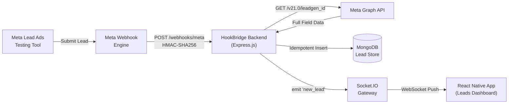

# HookBridge 🌉
### Real-Time Meta Lead Ads Integration with React Native

[]()
[]()
[]()
[]()
[]()
[]()
[]()

HookBridge is an enterprise-ready, real-time lead synchronization system that captures leads submitted via **Meta Lead Ads** and instantly displays them inside an already-open **React Native** mobile application with **zero manual refresh, button clicks, or app reloads**.

---

## 📋 Table of Contents
1. [Problem Statement & Solution](#-problem-statement--solution)
2. [Key Features](#-key-features)
3. [System Architecture](#-system-architecture)
4. [Technology Stack](#-technology-stack)
5. [Repository Structure](#-repository-structure)
6. [Prerequisites](#-prerequisites)
7. [Installation & Setup](#-installation--setup)
   - [1. Backend Setup](#1-backend-setup)
   - [2. Mobile Setup](#2-mobile-setup)
   - [3. MongoDB Setup](#3-mongodb-setup)
   - [4. Public Tunnel Setup (ngrok)](#4-public-tunnel-setup-ngrok)
8. [Meta Developer Configuration](#-meta-developer-configuration)
9. [Running the Application](#-running-the-application)
10. [End-to-End Testing with Meta Lead Ads Testing Tool](#-end-to-end-testing-with-meta-lead-ads-testing-tool)
11. [Automated Test Suite](#-automated-test-suite)
12. [API & WebSocket Reference](#-api--websocket-reference)
13. [Loom Demonstration Guides](#-loom-demonstration-guides)
14. [Security & Idempotency Model](#-security--idempotency-model)
15. [Troubleshooting](#-troubleshooting)

---

## 🎯 Problem Statement & Solution

### The Challenge
Meta Lead Ads generates high-intent customer leads. However, typical integrations rely on polling or batched webhooks, causing delayed follow-ups. Businesses lose up to 391% in conversion rates when lead follow-up exceeds 5 minutes. Furthermore, Meta Webhook payloads only deliver an event pointer (`leadgen_id`), not the actual contact information.

### The HookBridge Solution
1. **Captures Inbound Webhooks**: Receives Meta's real-time POST notifications with cryptographic HMAC-SHA256 signature verification.
2. **Immediate Acknowledgment**: Answers Meta with `200 OK EVENT_RECEIVED` in under 30ms to prevent delivery retries.
3. **Graph API Lead Fetch**: Queries Meta Graph API (v21.0) using a secure Page Access Token to retrieve contact fields (Name, Email, Phone, Form Data).
4. **Normalized Persistence**: Sanitizes varying field names into canonical properties and atomically persists to MongoDB with duplicate suppression.
5. **Instant WebSocket Push**: Emits a `new_lead` event to all connected React Native clients.
6. **Reactive UI Update**: Prepends the lead to the active mobile view in milliseconds.

---

## 🚀 Key Features

- ⚡ **Zero-Interaction Real-Time Updates**: Leads appear on the mobile screen automatically without user interaction.
- 🔒 **HMAC-SHA256 Cryptographic Verification**: Validates all incoming payloads against Meta's `X-Hub-Signature-256` header.
- 🛡️ **Race-Condition Proof Idempotency**: Unique indexing on `leadId` and multi-layered deduplication prevents duplicate entries.
- 🔄 **Resilient WebSocket Gateway**: Powered by Socket.IO with automatic reconnection backoff and visual connection badges.
- 📱 **Cross-Platform React Native Dashboard**: Runs seamlessly on Android Emulator, Physical Devices (Expo Go), and Web.
- 🧪 **Comprehensive Automated Testing**: 31+ unit and integration tests covering webhooks, Graph API errors, database constraints, and sockets.
- 📊 **Local Webhook Simulator**: Includes a built-in CLI tool to simulate Meta lead submissions locally.

---

## 🏗️ System Architecture



For complete architecture diagrams and sequence flows, see [docs/architecture.md](docs/architecture.md).

---

## 🛠️ Technology Stack

| Domain | Technology | Version | Description |
|---|---|---|---|
| **Mobile App** | React Native / Expo | 0.76 / SDK 52 | Clean mobile interface with functional hooks |
| **Mobile Socket** | Socket.IO Client | ^4.8.1 | Real-time event communication with backend |
| **Mobile HTTP** | Axios | ^1.7.9 | Initial lead fetching and health checks |
| **Backend Server**| Node.js / Express | v22.x / v4.21 | Modular REST & Webhook server |
| **Real-Time** | Socket.IO | ^4.8.1 | Bi-directional WebSocket communication |
| **Database** | MongoDB / Mongoose | ^8.9.5 | NoSQL document storage with unique indexes |
| **External API** | Meta Graph API | v21.0 | Official Meta Leadgen endpoint |
| **Security** | Crypto (HMAC-SHA256) | Native Node | Webhook signature verification |
| **Testing** | Jest / Supertest | ^29.7.0 | Automated unit and integration testing |
| **Tunneling** | ngrok | ^5.0.0 | Secure public HTTPS tunnel for Meta Webhooks |

---

## 📂 Repository Structure

```text
HookBridge/
├── backend/                         # Node.js + Express Backend
│   ├── src/
│   │   ├── config/
│   │   │   └── index.js             # Environment variable configuration
│   │   ├── controllers/
│   │   │   ├── health.controller.js # Server & database health checks
│   │   │   ├── lead.controller.js   # REST API for lead retrieval
│   │   │   └── webhook.controller.js# Webhook handshake & async lead processor
│   │   ├── middleware/
│   │   │   ├── errorHandler.js      # Centralized error handler
│   │   │   ├── requestLogger.js     # Structured request logger
│   │   │   └── verifyWebhookSignature.js # Meta HMAC-SHA256 verification
│   │   ├── models/
│   │   │   └── Lead.js              # Mongoose Lead schema with unique index
│   │   ├── routes/
│   │   │   ├── health.routes.js     # /api/health
│   │   │   ├── lead.routes.js       # /api/leads
│   │   │   └── webhook.routes.js    # /webhooks/meta
│   │   ├── services/
│   │   │   ├── metaGraphService.js  # Meta Graph API client (v21.0)
│   │   │   ├── leadProcessingService.js # Normalization & deduplication
│   │   │   └── socketService.js     # Socket.IO singleton server
│   │   ├── app.js                   # Express application setup
│   │   └── server.js                # Server entry point & DB connection
│   ├── tests/                       # 28 Automated Backend Tests
│   │   ├── api.test.js
│   │   ├── leadModel.test.js
│   │   ├── leadProcessingService.test.js
│   │   ├── metaGraphService.test.js
│   │   ├── socket.test.js
│   │   └── webhook.test.js
│   ├── scripts/
│   │   └── simulateLeadAd.js        # Local HMAC webhook test simulator
│   ├── .env.example
│   └── package.json
├── mobile/                          # React Native Mobile App
│   ├── src/
│   │   ├── components/
│   │   │   ├── ConnectionBadge.js   # Live socket status pill
│   │   │   ├── EmptyState.js        # Helpful instructions when list is empty
│   │   │   ├── Header.js            # App banner
│   │   │   ├── LeadCard.js          # Individual lead card UI
│   │   │   └── LeadStats.js         # Summary statistics
│   │   ├── config/
│   │   │   └── env.js               # Auto-detects Android/iOS/Web hosts
│   │   ├── screens/
│   │   │   └── LeadsDashboardScreen.js # Main leads list & socket listener
│   │   └── services/
│   │       ├── api.js               # Axios REST service
│   │       └── socket.js            # Socket.IO client manager
│   ├── tests/
│   │   └── dashboardLogic.test.js   # Mobile deduplication tests
│   ├── App.js                       # Root component
│   ├── app.json
│   ├── .env.example
│   └── package.json
├── docs/                            # Comprehensive System Documentation
│   ├── architecture.md              # Technical specs & sequence diagrams
│   ├── meta-setup.md                # Step-by-step Meta integration guide
│   ├── api-reference.md             # REST API & Socket schema reference
│   ├── assumptions.md               # Engineering & security assumptions
│   ├── troubleshooting.md           # Diagnostics for common issues
│   ├── loom-demo-script.md          # 5-minute video demo outline
│   └── loom-code-walkthrough.md     # Code & architecture walkthrough
├── .gitignore
├── package.json
└── README.md
```

---

## ⚡ Prerequisites

Ensure the following tools are installed on your machine:
- **Node.js**: v18.x or v22.x (`node -v`)
- **npm**: v9.x or v11.x (`npm -v`)
- **MongoDB**: Local MongoDB community edition running on `localhost:27017` or a MongoDB Atlas URI
- **ngrok**: For exposing your local webhook endpoint to Meta (`ngrok -v`)
- **Meta Developer Account**: Access to [developers.facebook.com](https://developers.facebook.com/)

---

## 🚀 Installation & Setup

### 1. Backend Setup

```bash
cd backend
npm install
cp .env.example .env
```

Configure your `backend/.env` with your Meta app credentials:
```env
PORT=5000
NODE_ENV=development
MONGODB_URI=mongodb://127.0.0.1:27017/hookbridge

# Meta Developer Credentials
META_APP_ID=your_meta_app_id
META_APP_SECRET=your_meta_app_secret
META_VERIFY_TOKEN=hookbridge_verify_token_secure_2026
META_PAGE_ACCESS_TOKEN=your_meta_page_access_token
META_GRAPH_API_VERSION=v21.0
CLIENT_URL=*
```

### 2. Mobile Setup

```bash
cd ../mobile
npm install
cp .env.example .env
```

The mobile client automatically routes to `http://10.0.2.2:5000` when running in an Android Emulator, and `http://localhost:5000` on web/iOS. For physical phones, set `API_BASE_URL` and `SOCKET_SERVER_URL` in `mobile/.env` to your machine's LAN IP (e.g. `http://192.168.1.50:5000`).

### 3. Public Tunnel Setup (ngrok)

Meta requires public HTTPS URLs for webhook callbacks. In a separate terminal:
```bash
ngrok http 5000
```
Note the forwarding HTTPS URL, e.g.: `https://xyz123.ngrok-free.app`.

---

## 🔑 Meta Developer Configuration

For an exhaustive step-by-step walk-through with screenshots and permission breakdowns, read [docs/meta-setup.md](docs/meta-setup.md).

### Quick Summary:
1. **Create Meta App**: Business type in Meta Developer Portal.
2. **Add Webhooks Product**: Choose **Page** as the object.
3. **Configure Callback**:
   - URL: `https://<YOUR_NGROK_DOMAIN>/webhooks/meta`
   - Verify Token: `hookbridge_verify_token_secure_2026`
4. **Subscribe to `leadgen`**: Under Page subscription fields, subscribe to `leadgen`.
5. **Get Page Access Token**: Generate a Page Access Token with `leads_retrieval` and `pages_manage_ads` permissions via [Graph API Explorer](https://developers.facebook.com/tools/explorer/).
6. **Subscribe Page to App**: Call `POST /{page-id}/subscribed_apps?subscribed_fields=leadgen&access_token={page-token}`.

---

## 🖥️ Running the Application

### 1. Start the Backend
```bash
cd backend
npm run dev
```
You should see:
```text
====================================================
  HOOKBRIDGE SERVER RUNNING ON PORT 5000
  Environment: development
  Health Check: http://localhost:5000/api/health
  Meta Webhook GET: http://localhost:5000/webhooks/meta
  Meta Webhook POST: http://localhost:5000/webhooks/meta
  Leads API: http://localhost:5000/api/leads
  Graph API Version: v21.0
====================================================
```

### 2. Start the Mobile Application
In a new terminal:
```bash
cd mobile
npm start
```
- Press `a` to open on an Android Emulator.
- Press `w` to open in your web browser.
- Scan the QR code with **Expo Go** to run on a physical Android/iOS device.

The Leads Dashboard will open and show **Live Socket Connected** (green badge).

---

## 🧪 End-to-End Testing with Meta Lead Ads Testing Tool

1. Open the [Meta Lead Ads Testing Tool](https://developers.facebook.com/tools/lead-ads-testing).
2. Select your **Page** and **Form**.
3. If an existing test lead is present, click **Delete Lead**.
4. Click **Preview Form**, fill in details (e.g. `John Doe`, `john@example.com`, `+1 555-0100`), and click **Submit** (or click **Create Lead**).
5. **Observe**:
   - Meta posts the notification to your ngrok tunnel.
   - HookBridge validates the HMAC signature and replies `EVENT_RECEIVED`.
   - HookBridge fetches the full lead via Meta Graph API v21.0.
   - The lead is saved in MongoDB.
   - Socket.IO broadcasts `new_lead`.
   - **The lead card immediately appears on your mobile screen without touching any button!**

### Local Webhook Simulator (Offline / Automated Testing)
To test the complete backend and mobile sync pipeline without waiting for Meta:
```bash
cd backend
npm run simulate:lead
```
This script computes a real HMAC-SHA256 signature using `META_APP_SECRET` and fires an authentic Meta payload to your local webhook!

---

## 🧪 Automated Test Suite

HookBridge includes 31 automated tests ensuring complete system reliability.

### Run All Tests:
```bash
# In backend:
cd backend && npm test

# In mobile:
cd ../mobile && npm test
```

### Backend Test Coverage:
- `tests/webhook.test.js`: Handshake GET verification, invalid token rejection, HMAC-SHA256 signature validation, missing header rejection.
- `tests/metaGraphService.test.js`: Lead retrieval, token expiration (190), permission errors (200), rate limits (4), token sanitization.
- `tests/leadProcessingService.test.js`: Field extraction, name combination, test lead detection, duplicate prevention.
- `tests/leadModel.test.js`: MongoDB unique constraints, duplicate key collision handling, chronological sorting.
- `tests/socket.test.js`: Real-time WebSocket connection, `new_lead` event emission, disconnect tracking.
- `tests/api.test.js`: Health checks, pagination, single lead retrieval.

---

## 📖 API & WebSocket Reference

See [docs/api-reference.md](docs/api-reference.md) for full request/response schemas.

| Method | Endpoint | Description |
|---|---|---|
| `GET` | `/api/health` | Backend status, DB state, connected socket count |
| `GET` | `/api/leads` | Paginated lead history sorted newest first |
| `GET` | `/api/leads/:id` | Single lead by Meta ID or MongoDB ID |
| `GET` | `/webhooks/meta` | Meta webhook subscription verification |
| `POST` | `/webhooks/meta` | Meta webhook event receiver (HMAC verified) |

### Socket.IO Channels:
- `connected`: Emitted to client upon handshake.
- `new_lead`: Broadcast to all connected clients when a lead is saved.

---

## 📹 Loom Demonstration Guides

Two presentation blueprints are included in the repository:
- **Loom 1 (Working Demo)**: [docs/loom-demo-script.md](docs/loom-demo-script.md) (Step-by-step 5-minute live test lead submission).
- **Loom 2 (Code & Architecture Walkthrough)**: [docs/loom-code-walkthrough.md](docs/loom-code-walkthrough.md) (Deep dive into security, Graph API, and React Native code).

---

## 🔒 Security & Idempotency Model

1. **HMAC-SHA256 Payload Verification**: Incoming payloads are validated against the raw byte buffer using `crypto.timingSafeEqual()`.
2. **Credential Redaction**: Access tokens are sanitized in all server logs (`EAAB...oken`).
3. **Database-Level Idempotency**: MongoDB enforces a unique index on `leadId`, preventing duplicate entries under concurrent webhook delivery.
4. **Client-Side Deduplication**: A `seenLeadIds` cache on the mobile client guarantees zero duplicate card rendering.

See [docs/assumptions.md](docs/assumptions.md) for detailed architectural assumptions.

---

## 🛠️ Troubleshooting

For solutions to common setup issues, see [docs/troubleshooting.md](docs/troubleshooting.md).

- **Token Mismatch**: Check `META_VERIFY_TOKEN` in `backend/.env`.
- **Signature Errors**: Verify `META_APP_SECRET` is correct.
- **Graph API Token Expired (Code 190)**: Re-generate your Page Access Token.
- **Mobile Connection Offline**: Check that port 5000 is reachable and `http://10.0.2.2:5000` is used for Android emulators.

---

## 📄 License
This project is licensed under the MIT License. Developed for technical assessment & demonstration.
