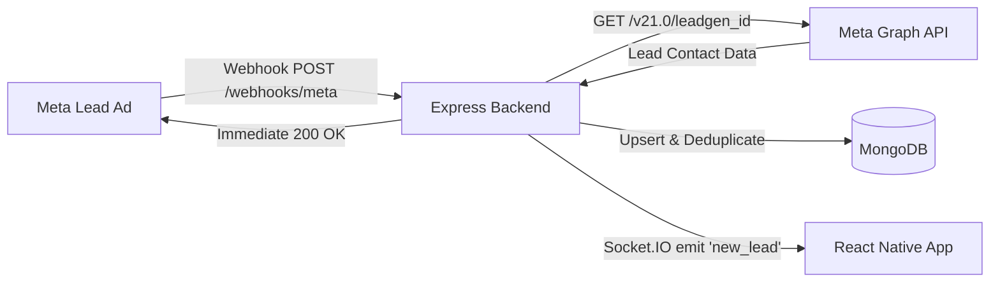

# HookBridge

Real-time integration between Meta Lead Ads and a React Native dashboard.

When a user submits a Meta Lead Ad form, Meta delivers a webhook notification. HookBridge verifies the webhook signature, fetches the full lead data via Meta Graph API v21.0, saves it in MongoDB, and pushes it over WebSockets (Socket.IO) to an active React Native app—updating the UI instantly with zero manual refresh.

---

## Architecture Flow



1. **Webhook Ingestion**: Express receives Meta's POST webhook and verifies the `X-Hub-Signature-256` HMAC signature using the raw request body.
2. **Immediate Acknowledgment**: The backend immediately returns `200 OK EVENT_RECEIVED` to stay well within Meta's 20-second timeout.
3. **Graph API Fetch**: In the background, the server calls Meta Graph API `GET /v21.0/{leadgen_id}` using a Page Access Token to retrieve contact details (name, email, phone, form questions).
4. **Data Normalization & Persistence**: Field names are normalized into canonical attributes and saved to MongoDB. A unique index on `leadId` guards against duplicate webhook deliveries.
5. **Real-Time Push**: The backend emits a `new_lead` event via Socket.IO.
6. **Instant UI Update**: The React Native client prepends the lead to the dashboard without requiring pull-to-refresh.

---

## Tech Stack

- **Backend**: Node.js, Express, Socket.IO, Mongoose, Axios, crypto
- **Database**: MongoDB (local or Atlas)
- **Mobile**: React Native (Expo SDK 52), Socket.IO Client, Axios
- **External APIs**: Meta Graph API v21.0 (Webhooks, Leadgen endpoints)
- **Testing**: Jest, Supertest

---

## Project Structure

```text
HookBridge/
├── backend/
│   ├── src/
│   │   ├── config/index.js               # Environment configuration
│   │   ├── controllers/
│   │   │   ├── health.controller.js      # /api/health endpoint
│   │   │   ├── lead.controller.js        # /api/leads REST endpoints
│   │   │   └── webhook.controller.js     # Meta verification & webhook handler
│   │   ├── middleware/
│   │   │   ├── errorHandler.js           # Error handling middleware
│   │   │   ├── requestLogger.js          # Request logger
│   │   │   └── verifyWebhookSignature.js # HMAC-SHA256 signature verification
│   │   ├── models/Lead.js                # Lead schema with unique leadId index
│   │   ├── routes/                       # Express routes (health, lead, webhook)
│   │   ├── services/
│   │   │   ├── leadProcessingService.js  # Field mapping & normalization
│   │   │   ├── metaGraphService.js       # Meta Graph API client
│   │   │   └── socketService.js          # Socket.IO connection manager
│   │   ├── app.js                        # Express setup with raw body capture
│   │   └── server.js                     # Entry point & DB connection
│   ├── scripts/
│   │   ├── simulateLeadAd.js             # Local webhook HMAC test script
│   │   └── triggerLead.js                # Direct DB insert & socket broadcast
│   ├── tests/                            # 28 backend unit & integration tests
│   └── package.json
├── mobile/
│   ├── src/
│   │   ├── components/                   # LeadCard, ConnectionBadge, LeadStats, EmptyState
│   │   ├── config/env.js                 # Dynamic host detection (Android/iOS/Web)
│   │   ├── screens/LeadsDashboardScreen.js # Real-time leads feed
│   │   └── services/                     # Socket.IO and Axios REST clients
│   ├── tests/                            # Mobile deduplication tests
│   ├── App.js
│   └── package.json
└── docs/                                 # Setup and reference guides
```

---

## Getting Started

### Prerequisites

- Node.js (v18 or v22)
- Local MongoDB running at `mongodb://127.0.0.1:27017` (or MongoDB Atlas connection string)
- ngrok (for exposing the webhook endpoint to Meta during live tests)

---

### 1. Backend Setup

```bash
cd backend
npm install
cp .env.example .env
```

Update `backend/.env` with your settings:

```env
PORT=5000
NODE_ENV=development
MONGODB_URI=mongodb://127.0.0.1:27017/hookbridge

# Meta Developer Credentials
META_APP_ID=your_app_id
META_APP_SECRET=your_app_secret
META_VERIFY_TOKEN=your_custom_verify_token
META_PAGE_ACCESS_TOKEN=your_page_access_token
META_GRAPH_API_VERSION=v21.0
CLIENT_URL=*
```

Start the server:

```bash
npm run dev
```

The server starts on `http://localhost:5000`.

---

### 2. Mobile Setup

```bash
cd mobile
npm install
cp .env.example .env
```

Start the Expo development server:

```bash
npm start
```

- Press `w` to open in browser (Web mode).
- Press `a` to launch in Android Emulator.
- Or scan the QR code using Expo Go on a physical phone.

*Note: For physical devices, set `API_BASE_URL` and `SOCKET_SERVER_URL` in `mobile/.env` to your computer's local network IP (e.g., `http://192.168.1.100:5000`).*

---

### 3. Expose Backend with ngrok (for Meta Webhooks)

Meta requires an HTTPS endpoint for webhook delivery:

```bash
ngrok http 5000
```

Copy the forwarding HTTPS URL (e.g. `https://xxxx.ngrok-free.app`).

---

## Meta Webhook Configuration

1. In the [Meta App Dashboard](https://developers.facebook.com/apps/):
   - Add the **Webhooks** product.
   - Select **Page** object and configure callback URL:
     - **Callback URL**: `https://<YOUR_NGROK_URL>/webhooks/meta`
     - **Verify Token**: value of `META_VERIFY_TOKEN` from your `.env`
   - Subscribe to the **leadgen** field.
2. Generate a Page Access Token with `leads_retrieval` and `pages_manage_ads` permissions in [Graph API Explorer](https://developers.facebook.com/tools/explorer/).
3. Subscribe your Facebook Page to the App:
   ```bash
   curl -X POST "https://graph.facebook.com/v21.0/{PAGE_ID}/subscribed_apps?subscribed_fields=leadgen&access_token={PAGE_ACCESS_TOKEN}"
   ```

---

## Testing

### Option A: Local Simulation (No Meta account required)

To test the entire real-time pipeline locally:

1. Keep your backend and mobile app running.
2. In a terminal, run:
   ```bash
   cd backend
   npm run simulate:lead
   ```
   This generates a realistic Meta webhook payload, signs it with `META_APP_SECRET` using HMAC-SHA256, and posts it to `/webhooks/meta`.
3. Or trigger a direct socket broadcast:
   ```bash
   cd backend
   node scripts/triggerLead.js
   ```
4. Watch the lead appear on the mobile dashboard immediately with the socket connection badge active.

### Option B: Meta Lead Ads Testing Tool

1. Open the [Meta Lead Ads Testing Tool](https://developers.facebook.com/tools/lead-ads-testing).
2. Select your Facebook Page and Lead Form.
3. Click **Preview Form**, fill in details, and submit (or click **Create Lead**).
4. Meta delivers the webhook to your ngrok URL. The backend retrieves the lead via Graph API and pushes it to your React Native app in real time.

### Option C: Automated Unit & Integration Tests

```bash
# Run backend tests (28 tests)
cd backend
npm test

# Run mobile tests (3 tests)
cd ../mobile
npm test
```

Test coverage includes:
- Webhook signature validation and GET verification handshake
- Meta Graph API error handling (token expired, permission missing, rate limit)
- Lead data normalization and duplicate key rejection
- Socket.IO connection and event emission
- Mobile deduplication state logic

---

## REST Endpoints

| Method | Route | Description |
|---|---|---|
| `GET` | `/api/health` | Service health, MongoDB connection status, connected socket count |
| `GET` | `/api/leads` | Paginated lead list (supports `?page=1&limit=20`) |
| `GET` | `/api/leads/:id` | Fetch single lead by Meta `leadId` or Mongo `_id` |
| `GET` | `/webhooks/meta` | Webhook verification handshake |
| `POST` | `/webhooks/meta` | Webhook event ingestion with HMAC validation |

---

## Key Implementation Notes

- **HMAC Signature Check**: Express preserves the raw request body buffer (`req.rawBody`) during JSON parsing to ensure cryptographic byte-for-byte comparison with `crypto.timingSafeEqual`.
- **Immediate Webhook Response**: To satisfy Meta's 20-second timeout, the webhook controller acknowledges with `200 OK EVENT_RECEIVED` right after signature validation, then handles Graph API fetching and socket broadcast asynchronously.
- **Idempotency & Deduplication**: MongoDB uses a unique index on `{ leadId: 1 }` to discard duplicate webhook deliveries. On the mobile client, a `seenLeadIdsRef` set provides an additional check before adding a lead to state.
