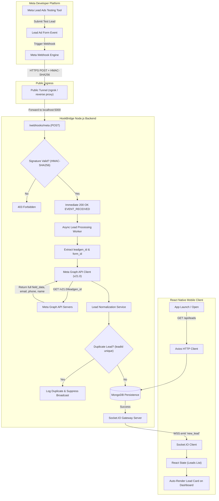
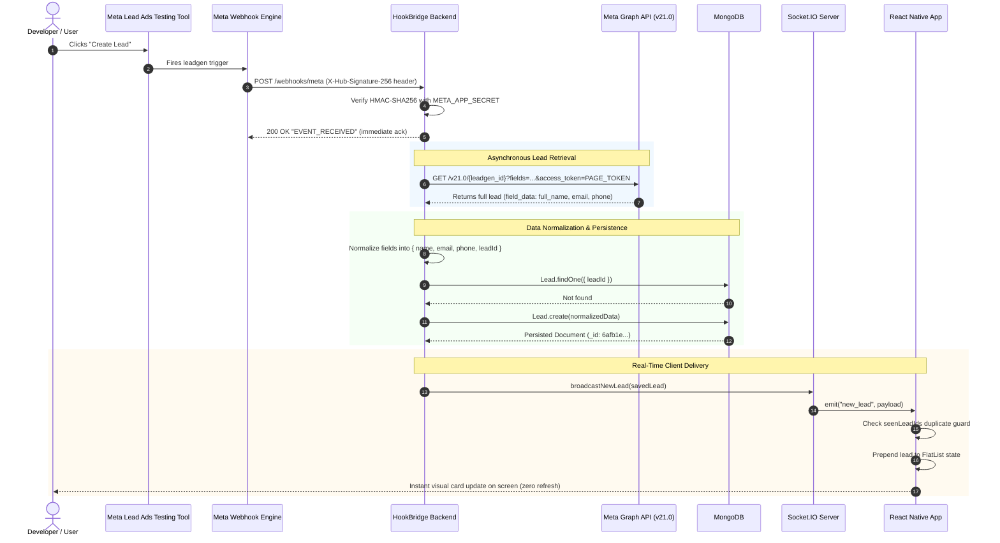

# HookBridge System Architecture & Technical Specifications

HookBridge is a real-time lead synchronization pipeline engineered to connect Meta Lead Ads with a React Native mobile application with zero manual user interaction.

---

## 1. High-Level Architecture Diagram

---

## 2. Sequence Diagram: Real-Time Lead Event Flow

---

## 3. Core Architectural Modules

### 3.1 Webhook Verification & Security Layer
1. **Handshake Verification (`GET /webhooks/meta`)**: Validates `hub.mode === 'subscribe'` and verifies `hub.verify_token` against `META_VERIFY_TOKEN`. Replies with `hub.challenge` as plain text.
2. **Payload Authenticity (`POST /webhooks/meta`)**: Evaluates `X-Hub-Signature-256`. Computes the HMAC-SHA256 signature using the raw unparsed request buffer and `META_APP_SECRET`. Compares signatures using timing-safe string comparison (`crypto.timingSafeEqual`) to prevent timing side-channel attacks.
3. **Immediate Acknowledgement**: Returns HTTP 200 `EVENT_RECEIVED` synchronously within milliseconds, completely avoiding Meta webhook delivery timeouts or duplicate retry floods.

### 3.2 Meta Graph API Integration Service
- Communicates directly with Meta Graph API endpoints using configured version (e.g. `v21.0`).
- Dynamically requests relevant lead attributes:
  - `id`: unique Meta lead ID
  - `created_time`: submission time
  - `field_data`: key-value array of submitted questions
  - `form_id`: associated lead generation form
  - `ad_id`, `adset_id`, `campaign_id`: campaign attribution data
- Employs secure Page Access Token authentication.
- Redacts and sanitizes tokens from error messages and logs (`EAAB...oken`).

### 3.3 Lead Normalization & Processing Engine
- Inspects heterogeneous Meta lead forms where questions might be labeled differently (e.g., `full_name`, `first_name` + `last_name`, `email`, `work_email`, `phone_number`, `mobile_number`).
- Sanitizes and formats contact details into canonical properties (`name`, `email`, `phone`).
- Preserves raw payloads and complete field mappings in MongoDB.

### 3.4 Idempotency & Persistence Engine
- Indexed unique constraint on `leadId`.
- Double-checked locking pattern: checks existence prior to insertion, and safely traps MongoDB duplicate key error code `11000` under race conditions.
- Guarantees that only strictly novel leads trigger real-time websocket broadcast events.

### 3.5 Real-Time WebSocket Gateway
- Powered by Socket.IO over WebSocket and polling fallback.
- Broadcasts persisted lead objects under the `new_lead` event channel.
- Automatically handles reconnection backoff and trackable connection state.

